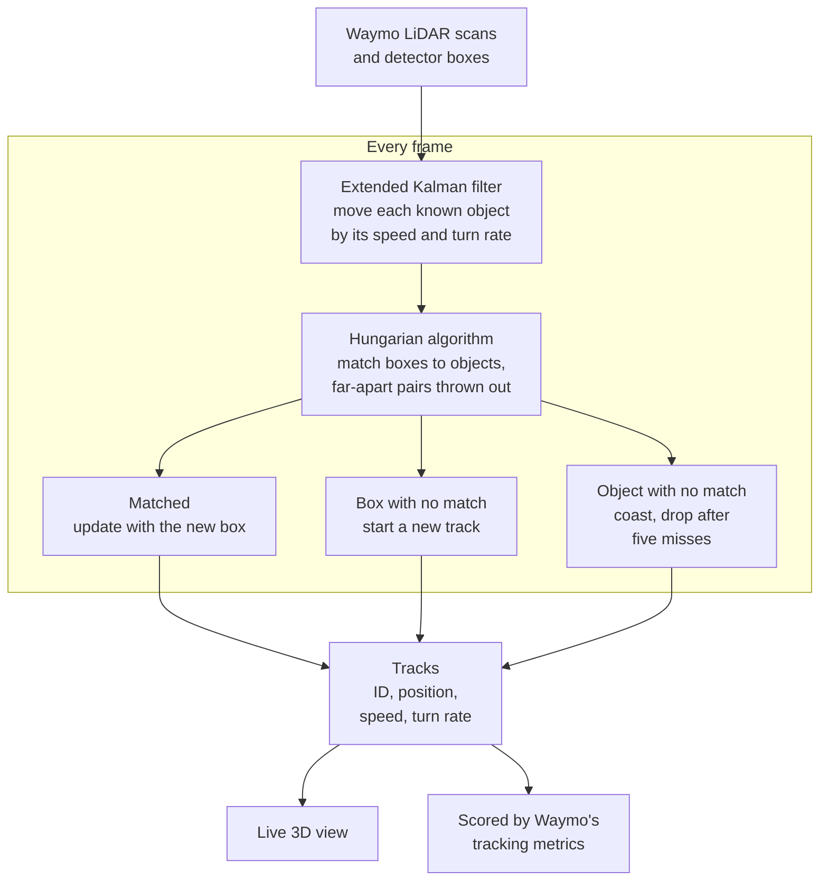

# Throughline

Real-time multi-object tracker for Waymo Open Dataset LiDAR, written in C++. It takes a
detector's 3D boxes for each scan, keeps a persistent ID on every car and pedestrian through
missed detections, and forecasts each one three seconds ahead. The scene streams to Lichtblick
while it runs.


*Blue boxes are tracked cars. The line in front of each one is where the tracker thinks it is
going.*

## Results

MOTA from Waymo's evaluator at LEVEL_2, on three validation clips. The input is CasA's
published detections. Boxes under 0.5 confidence are dropped, or under 0.7 for pedestrians.

| scene                       | cars | people |
|-----------------------------|------|--------|
| fast road, 63 km/h          | 0.30 | 0.22   |
| crawling through a junction | 0.54 | 0.57   |
| slow turn, 21 km/h          | 0.72 | 0.34   |

Most of the errors on the fast road are distant cars the detector missed. A frame takes 3 to
4 ms at the median and about 7 ms at the 99th percentile, against 100 ms between scans.

## How it works

Each track runs an extended Kalman filter over position, heading, speed and turn rate. New
boxes are matched to predicted tracks with the Hungarian algorithm, and pairs that are too far
apart are rejected. A track is confirmed after 3 hits and dropped after 5 misses.



## Build and run

Builds on macOS on Intel only: CMake downloads the x86_64 macOS Foxglove SDK and looks for
zstd and lz4 under `/usr/local`. Install `cmake`, `protobuf`, `zstd` and `lz4` with Homebrew.
Eigen, dlib, Catch2, CLI11, MCAP and the Foxglove SDK are fetched during configuration.
Staging needs Python with `pyarrow`, `numpy`, `pandas`, `protobuf` and
`mcap-protobuf-support`. Scoring needs Docker.

```
make test       # unit tests, no data needed
make stage      # stage one Waymo segment and its CasA boxes
make live       # track at the scans' own pace on ws://127.0.0.1:8765
make run        # track as fast as possible and write tracks.csv
make official   # score tracks.csv with Waymo's evaluator in Docker
```

Data paths default to `~/waymo-data`: Waymo's v2 Parquet files in `parquet/`, and CasA's
validation results in `casa/data/waymo/detections/val/result.pkl`. Override `DATA`,
`SEGMENT`, `DETECTIONS` or `PYTHON` on the `make` command line.

To watch, open Lichtblick, choose Open connection, then Foxglove WebSocket, and enter
`ws://127.0.0.1:8765`.

The Waymo Open Dataset needs a Waymo account. CasA's detection files are linked from the
[3D-Multi-Object-Tracker](https://github.com/hailanyi/3D-Multi-Object-Tracker) repository.

## Known limitations

- Forecast ellipses on newly confirmed cars are often too wide, and the cause hasn't been
  found.
- Latency with the viewer connected hasn't been measured.
